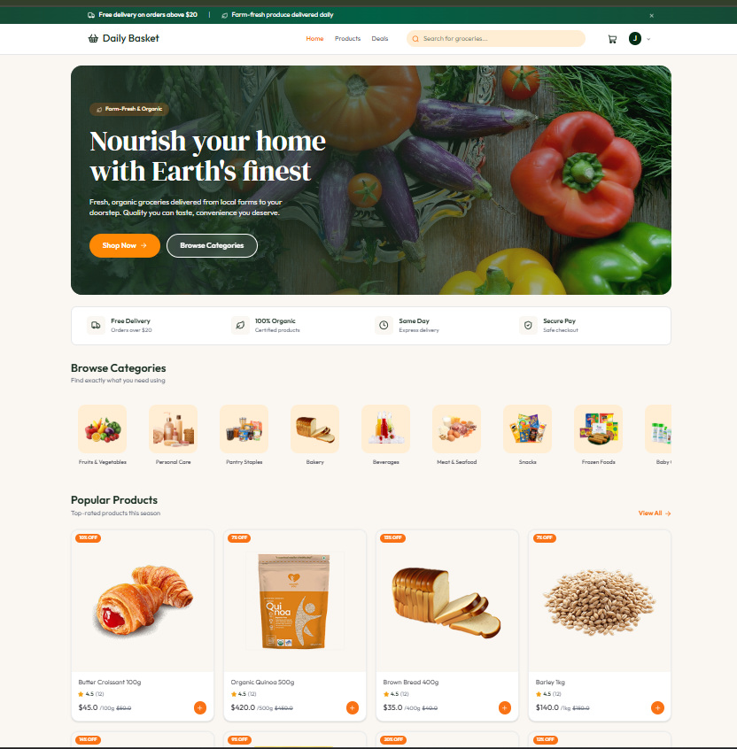

# Daily Basket

### Fresh groceries, a smoother way to shop.

Daily Basket is a responsive grocery storefront built with React and TypeScript. Browse everyday essentials, discover deals, manage a shopping cart, and explore checkout and order pages through a clean, produce-inspired interface.



## What you can do

- Browse products by category, search the catalog, and explore flash deals.
- View product details, ratings, and related shopping information.
- Add products to a cart, adjust quantities, and keep the cart saved in local storage.
- Use the checkout, delivery address, order history, and order tracking screens.
- Explore an admin dashboard overview.
- Navigate a responsive interface styled with Tailwind CSS.

> **Demo note:** This frontend currently uses sample catalog and order data. Checkout and account-related screens demonstrate the shopping flow; connect an API and authentication service to make them persistent and production-ready.

## Built with

| Area | Tools |
| --- | --- |
| UI | React 19, TypeScript |
| Development and build | Vite |
| Styling | Tailwind CSS 4 |
| Navigation | React Router |
| Icons and notifications | Lucide React, React Hot Toast |
| Maps | Leaflet, React Leaflet |

## Get started

### Requirements

- Node.js and npm

### Run locally

From this `frontEnd` directory:

```bash
npm install
npm run dev
```

Open the local URL printed by Vite in your terminal.

## Available scripts

| Command | Description |
| --- | --- |
| `npm run dev` | Start the Vite development server. |
| `npm run build` | Type-check and build the production app into `dist/`. |
| `npm run preview` | Preview the production build locally. |
| `npm run lint` | Run ESLint. |

## Main routes

| Route | Page |
| --- | --- |
| `/` | Home and featured products |
| `/products` | Product catalog |
| `/products/:id` | Product details |
| `/search` | Search results |
| `/deals` | Flash deals |
| `/login` | Login screen |
| `/checkout` | Checkout |
| `/orders` | Order history |
| `/orders/:id` | Order tracking |
| `/addresses` | Saved delivery addresses |
| `/admin` | Admin dashboard |

## Project layout

```text
src/
├── assets/       # Product imagery, sample data, and storefront screenshot
├── components/   # Shared UI components and route helpers
├── context/      # Shopping cart state and persistence
├── pages/        # Store, checkout, order, and admin screens
├── types/        # Shared TypeScript types
└── utils/        # Formatting helpers
```

## Production build

```bash
npm run build
npm run preview
```

The production-ready files are generated in `dist/`.
